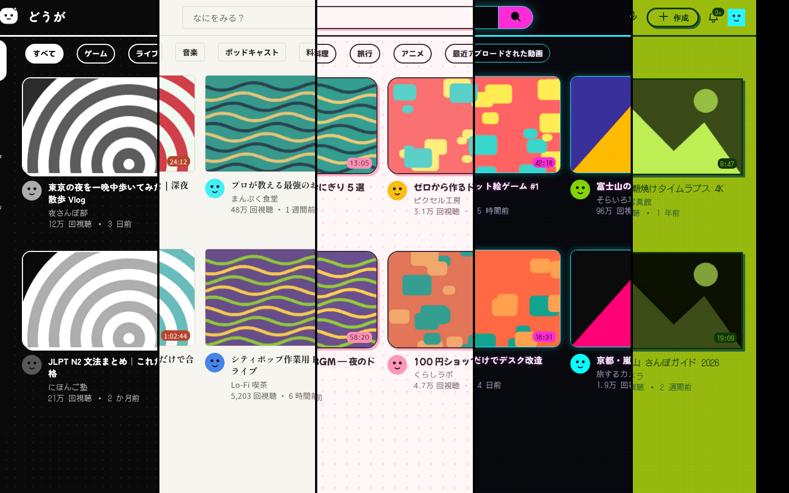
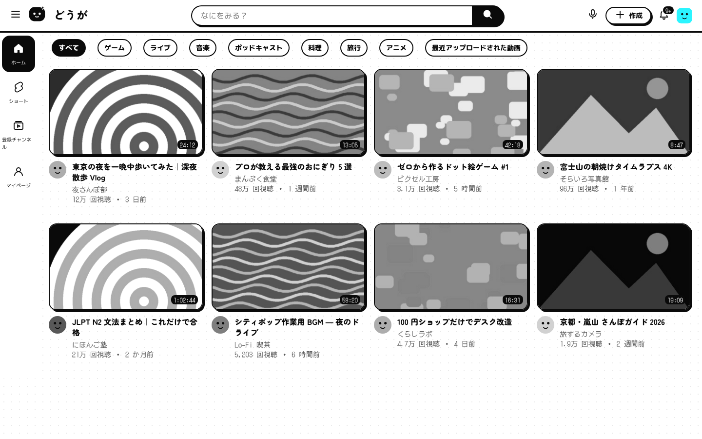
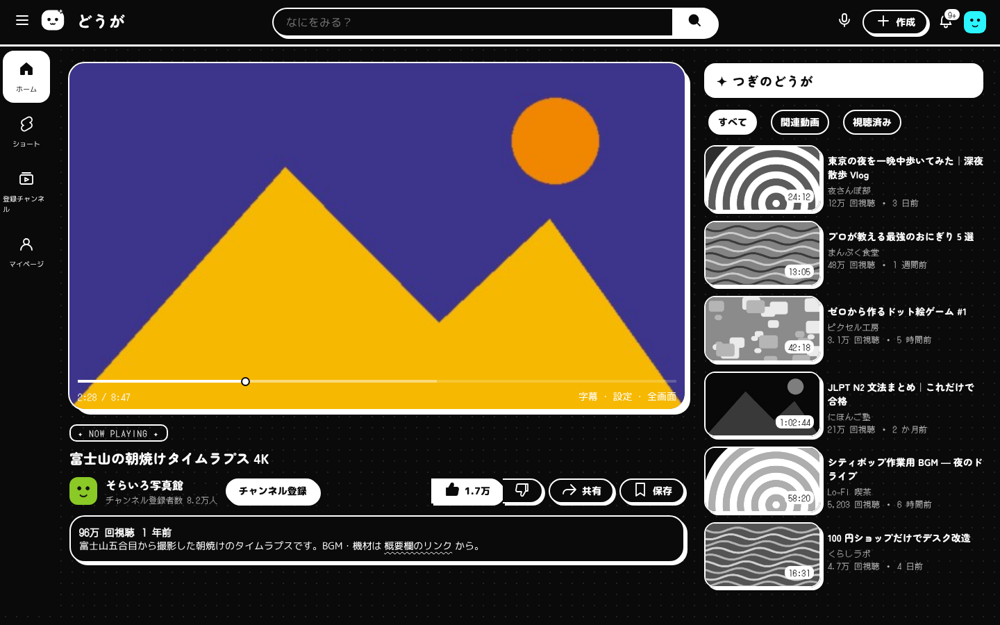
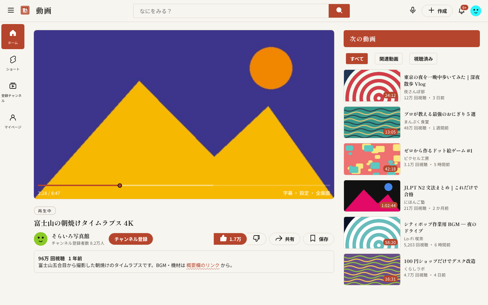
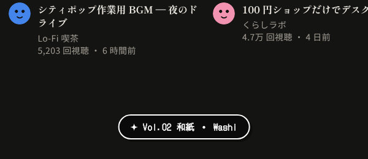
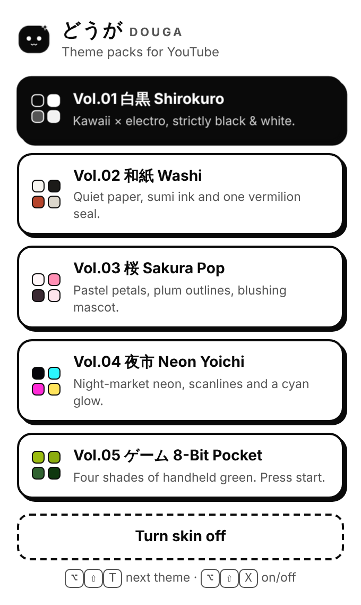

<div align="center">


# DOUGA どうが

### Five hand-made Japanese theme packs for YouTube.

Black-and-white kawaii, quiet washi paper, sakura pastels, night-market neon and a pocket 8-bit handheld. One install, every volume, one keystroke to switch.

[](CHANGELOG.md)
[](LICENSE)


[**Download**](#get-douga-in-60-seconds) · [**Install guide**](docs/INSTALL.md) · [**The collection**](docs/THEMES.md) · [**FAQ**](#faq)



</div>

---

## YouTube, but it feels like yours

YouTube looks the same for two billion people. DOUGA gives your copy a personality — a complete visual redesign of the pages you actually live on, built around Japanese graphic design: rounded *maru gothic* type, pixel fonts for the numbers, sticker outlines, hanko seals and paper textures.

It is not a colour filter. Every volume restyles the header, search, chips, thumbnails, badges, avatars, buttons, player, description, comments panel, menus and scrollbars — and keeps YouTube's Japanese interface text exactly as it is, so dates still read `2 時間前` and views still read `1.6万 回視聴`.

<table>
<tr>
<td width="33%" valign="top">

**✦ Five complete volumes**<br>
Each one a full art direction, not a palette swap — its own type, shapes, shadows, logo mascot and labels.

</td>
<td width="33%" valign="top">

**⌥ ⇧ T to switch**<br>
Flip between volumes instantly, right on the page. A little toast tells you where you landed. ⌥ ⇧ X turns the skin off.

</td>
<td width="33%" valign="top">

**◐ Light & dark aware**<br>
Shirokuro, Washi and Sakura follow your YouTube appearance setting. Neon and 8-Bit keep their own night and day.

</td>
</tr>
<tr>
<td valign="top">

**🔒 Private by design**<br>
No tracking, no account, no analytics. The only network request is Google Fonts for the typefaces.

</td>
<td valign="top">

**⚡ Zero lag**<br>
Pure CSS on top of YouTube's own design tokens — no DOM rewriting, no polling loops, nothing slowing the player.

</td>
<td valign="top">

**🧩 Works where you browse**<br>
Safari, Chrome, Arc, Edge, Brave and Firefox — as an extension, a userscript or a Stylus style.

</td>
</tr>
</table>

---

## The collection

Every volume is a sequel with its own story. Full palettes, type specs and design notes live in **[docs/THEMES.md](docs/THEMES.md)**.

### Vol.01 白黒 Shirokuro — *kawaii × electro, strictly black & white*

The flagship. Thick sticker outlines, hard offset shadows, a dot-grid background and a pixel font for every number. Thumbnails turn monochrome and bloom back into colour when you hover.


<table><tr>
<td></td>
<td></td>
</tr></table>

### Vol.02 和紙 Washi — *quiet paper, sumi ink and one vermilion seal*

The calm one. Hairline borders, Mincho headings, a red *hanko* stamp for a logo and nothing that shouts. Made for long evenings and documentaries.

<table><tr>
<td></td>
<td></td>
</tr></table>

### Vol.03 桜 Sakura Pop — *pastel petals, plum outlines, blushing mascot*

Spring in a browser tab. Soft pink stickers with plum outlines, a polka-dot ground and the bounciest display type in the set. Comes with a 夜桜 night mode.

<table><tr>
<td></td>
<td></td>
</tr></table>

### Vol.04 夜市 Neon Yoichi — *night-market neon, scanlines and a cyan glow*

After midnight in a back-alley arcade. Glowing cyan edges, magenta highlights, CRT scanlines and an ON AIR tag above whatever you are watching.

<table><tr>
<td></td>
<td></td>
</tr></table>

### Vol.05 ゲーム 8-Bit Pocket — *four shades of handheld green. Press start.*

Square corners, chunky 3-pixel borders, a pixel mascot and every thumbnail tinted to a four-shade LCD. "NEXT STAGE ▸" has never looked so good.

<table><tr>
<td></td>
<td></td>
</tr></table>

<sub>Screenshots are rendered from the real DOUGA stylesheet on an offline demo page with sample titles and abstract artwork.</sub>

---

## Switch in a keystroke

| Shortcut | What it does |
|---|---|
| <kbd>⌥ Option</kbd> + <kbd>⇧ Shift</kbd> + <kbd>T</kbd> &nbsp;(<kbd>Alt</kbd> on Windows/Linux) | Next volume |
| <kbd>⌥ Option</kbd> + <kbd>⇧ Shift</kbd> + <kbd>X</kbd> | Skin on / off |
| Toolbar icon (extension only) | Pick a volume from the menu |

<table><tr>
<td valign="top"></td>
<td valign="top"></td>
</tr></table>

Your choice is remembered per browser.

---

## Get DOUGA in 60 seconds

| Your browser | Best way | Time |
|---|---|---|
| **Safari** (Mac) | Free *Userscripts* app + [`douga.user.js`](dist/douga.user.js) | ~2 min |
| **Arc · Chrome · Edge · Brave** | Extension → *Load unpacked* | ~1 min |
| **Firefox** | Violentmonkey + [`douga.user.js`](dist/douga.user.js) | ~1 min |
| **Any browser with Stylus** | One style per volume from [`dist/stylus/`](dist/stylus) | ~1 min |
| **Safari, native extension** | Build with Xcode via [`scripts/build-safari.sh`](scripts/build-safari.sh) | ~10 min |

👉 **Step-by-step instructions with every click: [docs/INSTALL.md](docs/INSTALL.md)**

The short version for Arc / Chrome:

1. Download **[`douga-extension-v1.0.0.zip`](https://github.com/vurado0/douga-youtube-themes/raw/main/dist/douga-extension-v1.0.0.zip)** and unzip it.
2. Open `arc://extensions` (or `chrome://extensions`), switch on **Developer mode**.
3. Click **Load unpacked** and choose the `douga-extension` folder. Open YouTube. Done.

---

## Pricing

<table>
<tr>
<td align="center" width="50%">

### Free
**$0 — forever**

All five volumes · every future volume · all browsers · source code included

[Download →](#get-douga-in-60-seconds)

</td>
<td align="center" width="50%">

### Support the series
**A ⭐ on GitHub**

Stars decide which volume gets made next. Ideas for Vol.06? [Open an issue](https://github.com/vurado0/douga-youtube-themes/issues).

</td>
</tr>
</table>

---

## FAQ

**Is it safe?**  DOUGA is a few hundred lines of CSS and one small script you can read in this repo. It asks for one extension permission — `storage`, to remember your volume — and it only runs on `www.youtube.com`.

**Does it collect anything?**  No. There is no server. The only outside request is to Google Fonts to load the typefaces.

**Will my YouTube language change?**  No. DOUGA never rewrites text — whatever language YouTube shows you stays. It was designed with the Japanese interface in mind and works with every other language too.

**Does it work with YouTube Premium, logged out, in theater mode?**  Yes. In theater and fullscreen the player frame steps aside so the video gets the whole screen.

**YouTube changed something and a part looks off.**  YouTube ships layout changes regularly. [Open an issue](https://github.com/vurado0/douga-youtube-themes/issues) with a screenshot — fixes go out as new versions.

**Can I make my own volume?**  Yes — a volume is about 30 lines of design tokens. See [Make your own volume](docs/THEMES.md#make-your-own-volume).

---

## On the drawing board

Ideas for upcoming volumes — vote with an issue or a star:
- **Vol.06 抹茶 Matcha Café** — creamy greens, latte foam and wooden-menu type
- **Vol.07 ブラウン管 Showa CRT** — warm 1980s television, rounded glass and VHS labels
- **Vol.08 雪 Yuki** — winter white, frosted panels and falling-snow dots
- Search results and channel pages
- Firefox Add-ons and Chrome Web Store listings

---

## Build from source

```bash
git clone https://github.com/vurado0/douga-youtube-themes.git
cd douga-youtube-themes
pip install pillow
python3 scripts/build.py          # → dist/ (extension, userscript, Stylus styles)
```

```
src/base.css           maps YouTube's components onto design tokens
src/themes/*.css       one file per volume — tokens only
src/logos/*.svg        each volume's mascot
src/content.template.js  theme switcher, shortcuts, toast
src/popup/             extension toolbar menu
scripts/build.py       builds everything in dist/
scripts/build-safari.sh  native Safari extension (needs Xcode)
scripts/render_previews.py  renders the screenshots in this README
```

---

<div align="center">
<sub>DOUGA is an independent fan project and is not affiliated with, endorsed by or sponsored by YouTube or Google. YouTube is a trademark of Google LLC.<br>Made with care · MIT licensed · どうが means "video".</sub>
</div>
