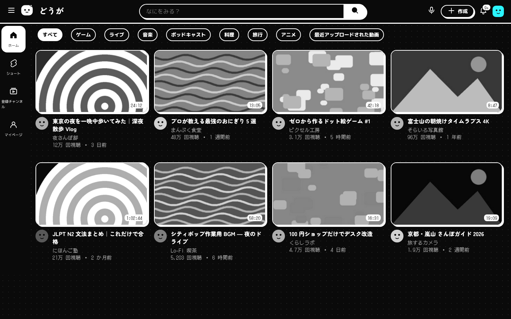
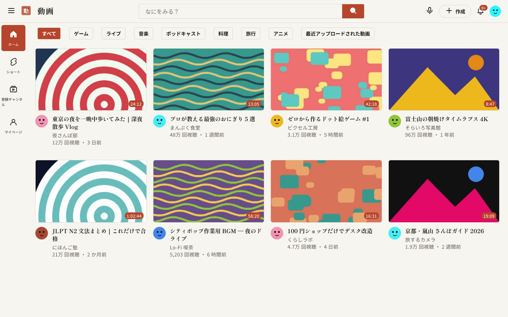
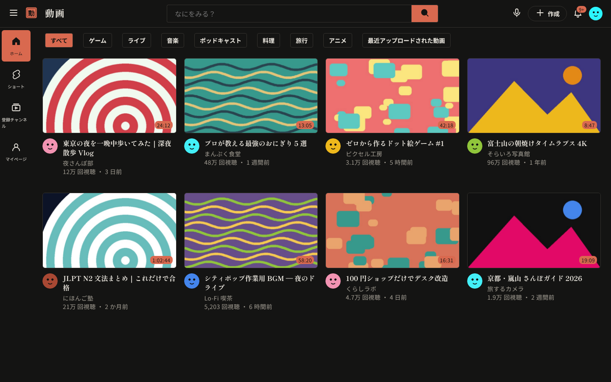
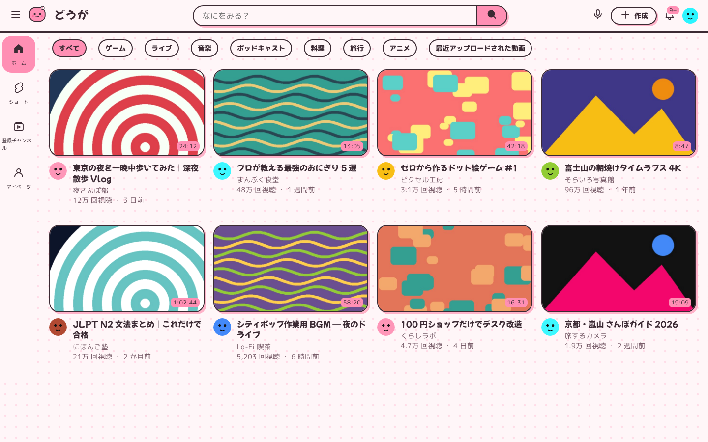
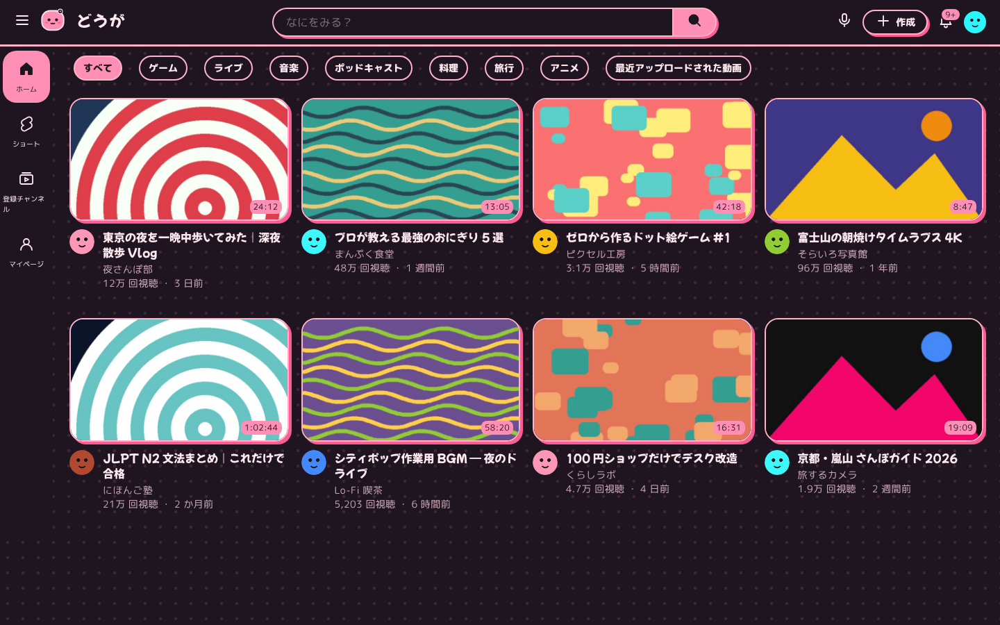
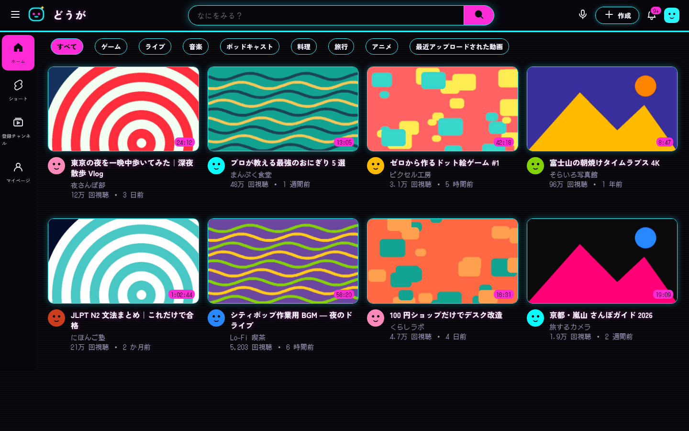
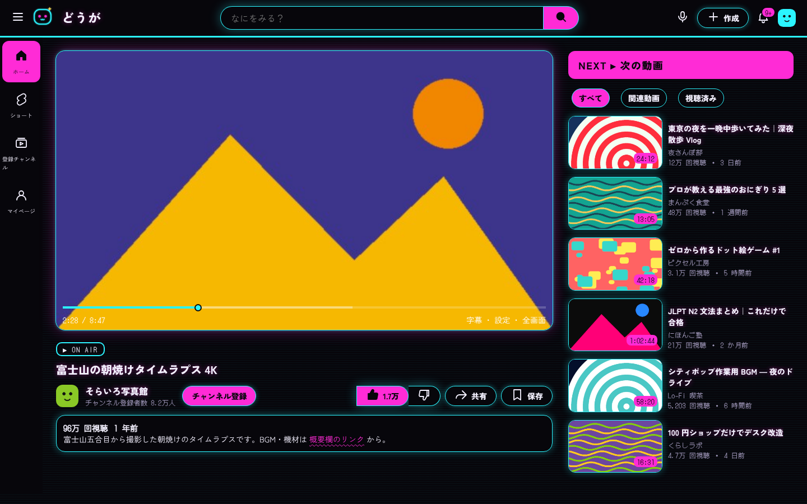
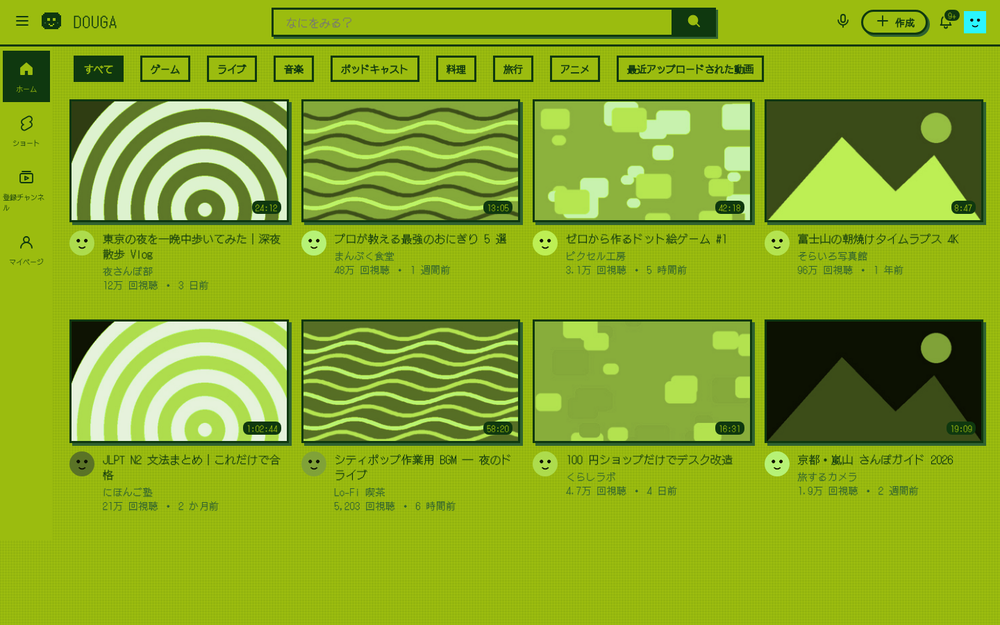
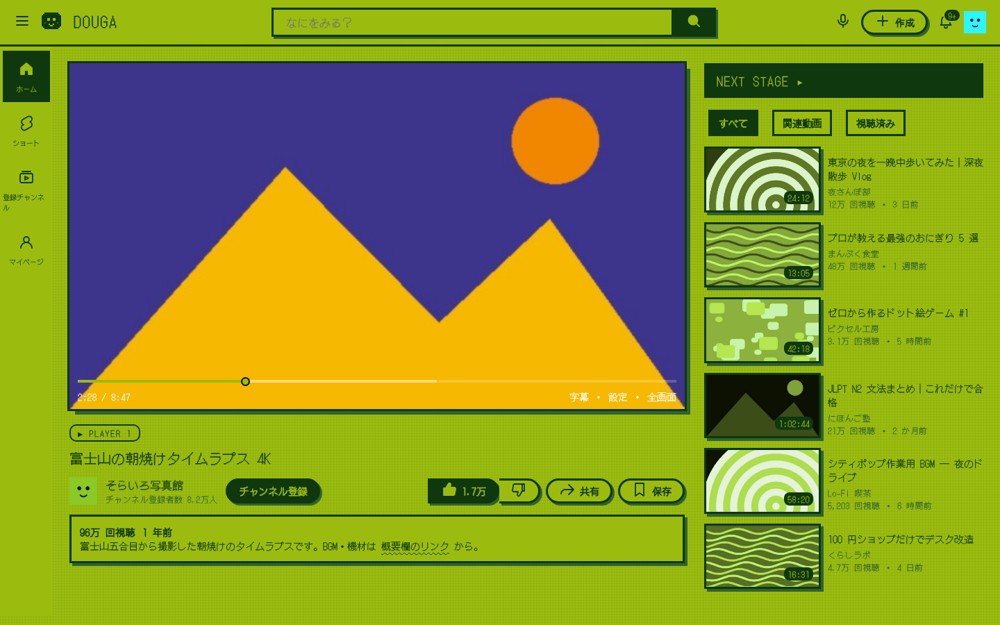

# The DOUGA collection

DOUGA is released as a series. Every **volume** is a complete art direction for YouTube — palette, type, shape language, shadows, mascot and on-page labels — built on the same engine, so each new volume is a sequel rather than a reskin.

| Vol. | Name | Mood | Appearance |
|---|---|---|---|
| 01 | 白黒 **Shirokuro** | kawaii × electro, black & white | follows YouTube light/dark |
| 02 | 和紙 **Washi** | quiet paper, sumi, vermilion seal | follows YouTube light/dark |
| 03 | 桜 **Sakura Pop** | pastel kawaii, plum outlines | follows YouTube light/dark (夜桜 night) |
| 04 | 夜市 **Neon Yoichi** | night-market neon, CRT | always dark |
| 05 | ゲーム **8-Bit Pocket** | four-shade handheld LCD | always green |

---

## Vol.01 白黒 Shirokuro

> *Kawaii × electro, strictly black & white.*

**Story.** The first volume asks how cute something can be with no colour at all. The answer is outlines: every surface becomes a sticker with a thick black edge and a hard shadow, the logo becomes a little face with a sparkle, and numbers switch to a pixel font, like a handheld music player from 2004.



| Token | Light (しろ) | Dark (くろ) |
|---|---|---|
| Ground | `#FFFFFF` | `#0A0A0A` |
| Ink & outlines | `#0A0A0A` | `#FFFFFF` |
| Secondary text | `#555555` | `#B8B8B8` |
| Soft fill | `#F2F2F2` | `#161616` |
| Pattern | 16 px dot grid, 9 % ink | 16 px dot grid, 10 % ink |

- **Type:** Zen Maru Gothic 900 for titles · M PLUS Rounded 1c for body · DotGothic16 for views, dates, durations
- **Shape:** 2.5 px outlines · 16 px card radius · pill chips · rounded-square avatars (30 %)
- **Depth:** hard offset shadows, 3 / 4 / 8 px, lifting on hover
- **Imagery:** thumbnails and avatars in greyscale, full colour on hover
- **Labels:** `✦ NOW PLAYING ✦` · `✦ つぎのどうが` · search: `なにをみる？`

---

## Vol.02 和紙 Washi

> *Quiet paper, sumi ink and one vermilion seal.*

**Story.** The sequel turns the volume down. Inspired by Japanese stationery and museum signage: warm paper, ink-black text, hairline rules and exactly one colour — the red of a *hanko* seal, used for the logo, the active states and nothing else.

<table><tr>
<td></td>
<td></td>
</tr></table>

| Token | Light (和紙) | Dark (墨) |
|---|---|---|
| Ground | `#F7F5F0` paper | `#141413` sumi |
| Ink | `#1C1B19` | `#ECE8E0` |
| Secondary text | `#625E56` | `#A39E94` |
| Hairlines | `#DCD7CC` | `#34322E` |
| Accent (朱) | `#B5452C` | `#D9694F` |

- **Type:** Shippori Mincho 700 for titles · Noto Sans JP for body and numbers
- **Shape:** 1 px hairlines · 6 px radius · 4 px chips · round avatars
- **Depth:** flat; a soft lift on hover only
- **Imagery:** thumbnails slightly desaturated (85 %)
- **Labels:** `再生中` · `次の動画` · logo `動画` with a 動 seal

---

## Vol.03 桜 Sakura Pop

> *Pastel petals, plum outlines, blushing mascot.*

**Story.** Spring arrives. The sticker language from Vol.01 comes back, now in pink — plum outlines instead of black, petal-pink shadows, polka dots, and a mascot with blushing cheeks. The night mode, 夜桜 *yozakura*, is cherry blossoms under lanterns.

<table><tr>
<td></td>
<td></td>
</tr></table>

| Token | Light (桜) | Night (夜桜) |
|---|---|---|
| Ground | `#FFF6F8` | `#1E1520` |
| Ink | `#3B2A33` plum | `#FFE9F0` |
| Secondary text | `#7A5F6B` | `#C9A6B4` |
| Outlines | `#3B2A33` | `#FFB3C9` |
| Accent | `#FF8FB4` | `#FF8FB4` |
| Shadow | `#FFB3C9` | `#FF5C93` |

- **Type:** Mochiy Pop One for titles · M PLUS Rounded 1c for everything else
- **Shape:** 2 px outlines · 20 px radius · round avatars
- **Depth:** pink offset shadows, 3 / 4 / 7 px
- **Pattern:** 22 px polka dots
- **Labels:** `✿ いまみてる` · `✿ つぎはこれ`

---

## Vol.04 夜市 Neon Yoichi

> *Night-market neon, scanlines and a cyan glow.*

**Story.** The series goes out after dark. A *yoichi* is a night market; this volume is its arcade corner — near-black violet ground, cyan tubes for every edge, magenta for anything active, a faint CRT scanline over the whole page, and an `ON AIR` tag above the video like a studio light.

<table><tr>
<td></td>
<td></td>
</tr></table>

| Token | Value |
|---|---|
| Ground | `#07060B` |
| Ink | `#F4F1FF` |
| Secondary text | `#A79FC2` |
| Edges (cyan tube) | `#2BF5FF` |
| Accent (magenta) | `#FF2BD6` |
| Spark | `#FFE45C` |

- **Type:** Zen Kaku Gothic New for titles and body · DotGothic16 for numbers · magenta glow on titles
- **Shape:** 1.5 px edges · 12 px radius
- **Depth:** glow instead of shadow — cyan at rest, magenta on hover
- **Pattern:** 4 px CRT scanlines
- **Labels:** `▶ ON AIR` · `NEXT ▸ 次の動画`

---

## Vol.05 ゲーム 8-Bit Pocket

> *Four shades of handheld green. Press start.*

**Story.** The finale of the first season shrinks YouTube into a pocket console. Four greens and nothing else, square corners, 3-pixel borders, a pixel-art mascot, and every thumbnail tinted to the LCD so the whole home page looks like a cartridge menu.

<table><tr>
<td></td>
<td></td>
</tr></table>

| Shade | Value | Used for |
|---|---|---|
| Lightest | `#9BBC0F` | ground |
| Light | `#8BAC0F` | soft fills |
| Dark | `#306230` | secondary text, shadows |
| Darkest | `#0F380F` | ink, outlines, active states |

- **Type:** DotGothic16 everywhere · wordmark `DOUGA`
- **Shape:** 3 px borders · 0 px radius · square avatars
- **Depth:** hard `#306230` offset shadows
- **Pattern:** 4 px pixel grid
- **Imagery:** thumbnails mapped to green LCD tones, real colour on hover
- **Labels:** `▶ PLAYER 1` · `NEXT STAGE ▸`

---

## Make your own volume

A volume is one CSS file in `src/themes/` that only sets design tokens. `src/base.css` maps those tokens onto every YouTube component.

1. Copy a volume, e.g. `src/themes/02-washi.css` → `src/themes/06-matcha.css`.
2. Edit the header — the build reads it:
   ```css
   /* @id matcha
      @vol 06
      @name Matcha Café
      @jp 抹茶
      @tagline Creamy greens and latte foam.
      @swatches #F3EFE3,#5B6B3A,#2E2A20,#E3DCC8 */
   ```
3. Set the tokens (see the table below). Colours go in `html:not([dark])` and `html[dark]`; shape and type go in `html`. Logos: drop an SVG in `src/logos/` and reference it as `url("{{logo:my-logo.svg}}")` — the build inlines it.
4. Build and try it: `python3 scripts/build.py`, reload the extension, press <kbd>⌥</kbd> <kbd>⇧</kbd> <kbd>T</kbd> until your volume appears.
5. Render screenshots (optional): add it to `THEMES` in `scripts/render_previews.py`, then `cd preview && npm install && cd .. && python3 scripts/render_previews.py`.

### Token reference

| Token | What it controls |
|---|---|
| `--kw-bg` | page and surface background |
| `--kw-ink` | main text and icons |
| `--kw-sub` | secondary text (channel, views, dates) |
| `--kw-soft` | subtle fills (hover, chip background layers) |
| `--kw-line` | outlines, borders, header rule, scrollbar |
| `--kw-accent` / `--kw-on-accent` | active chip, filled buttons, badges, up-next header / text on top of it |
| `--kw-logo` | `url(...)` of the logo mascot |
| `--kw-logo-text` | wordmark next to the mascot (string) |
| `--kw-bw` | border width |
| `--kw-r`, `--kw-r-lg`, `--kw-pill` | radius for cards, player & panels, chips & buttons |
| `--kw-avatar-r` | avatar radius |
| `--kw-shadow-sm`, `--kw-shadow`, `--kw-shadow-lg`, `--kw-shadow-hover` | box-shadow values (offset, glow, or `none`) |
| `--kw-lift` | transform applied to thumbnails on hover |
| `--kw-pattern`, `--kw-pattern-size` | page background image (dots, scanlines, grid) |
| `--kw-thumb-filter` | CSS filter on thumbnails and avatars (removed on hover) |
| `--kw-title-shadow` | text-shadow on titles and wordmark |
| `--kw-progress` | player progress bar and scrubber |
| `--kw-header-bw` | thickness of the line under the header |
| `--kw-font-body`, `--kw-font-display`, `--kw-font-meta` | body text, titles, numbers & metadata |
| `--kw-display-weight` | weight for titles |
| `--kw-now-playing`, `--kw-next-label` | label above the video title / header above recommendations (strings) |

Fonts come from Google Fonts. If your volume needs a new family, add it to `FONTS` in `scripts/build.py` (and to `preview/demo.html` for screenshots).
